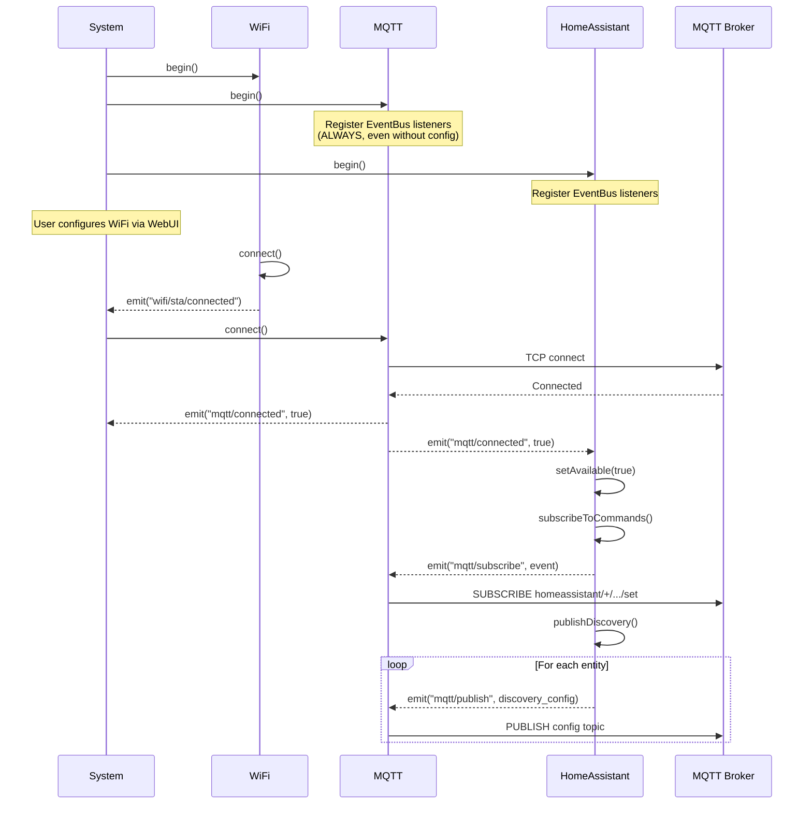
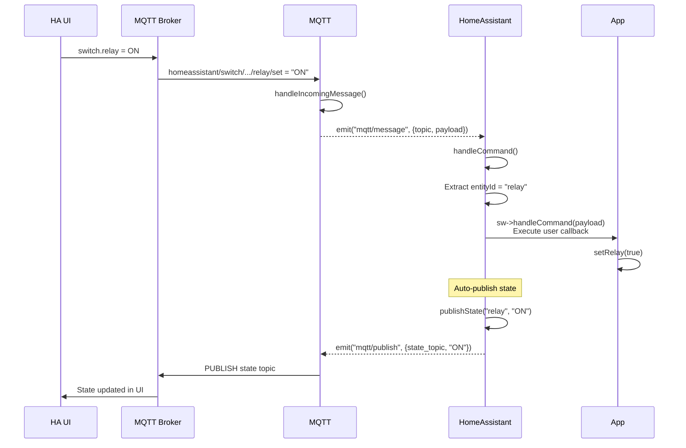

<!-- workline
sources: [DomoticsCore-System/include/DomoticsCore/System.h, DomoticsCore-Wifi/include/DomoticsCore/Wifi.h, DomoticsCore-Wifi/include/DomoticsCore/WifiEvents.h, DomoticsCore-MQTT/include/DomoticsCore/MQTT_impl.h, DomoticsCore-MQTT/include/DomoticsCore/MQTTEvents.h, DomoticsCore-HomeAssistant/include/DomoticsCore/HomeAssistant.h, DomoticsCore-HomeAssistant/include/DomoticsCore/HASwitch.h]
checked: 6687dc4
verified: agent:claude-code
-->
# EventBus Event Flow Diagram

Part of the [EventBus Architecture](eventbus-architecture.md) reference.

## System Boot Sequence

## Command Handling Flow

